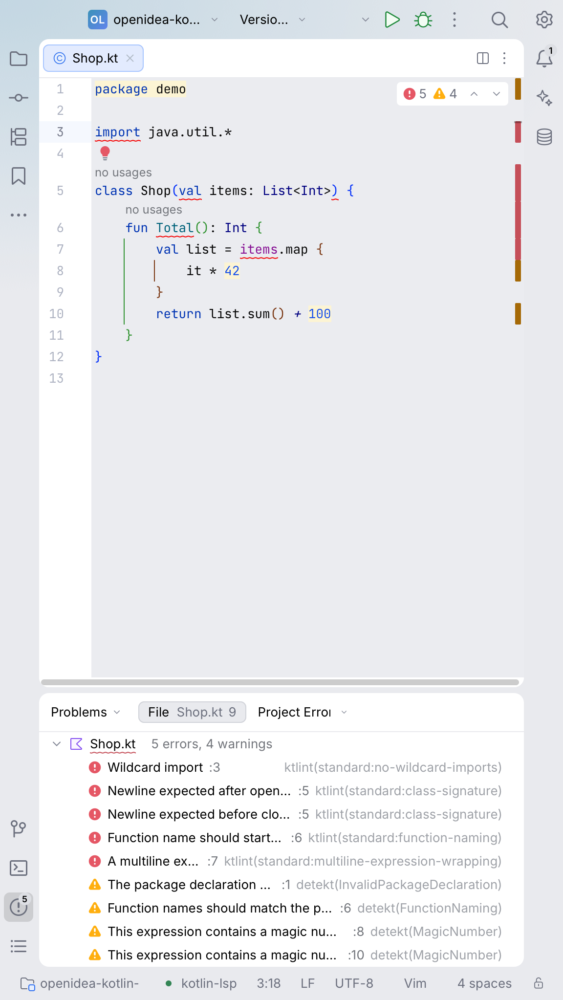
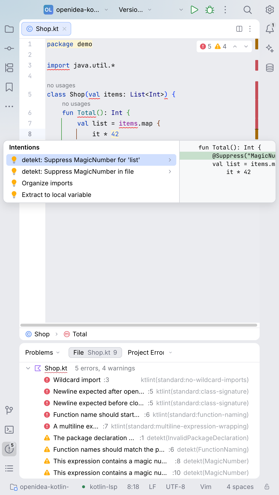
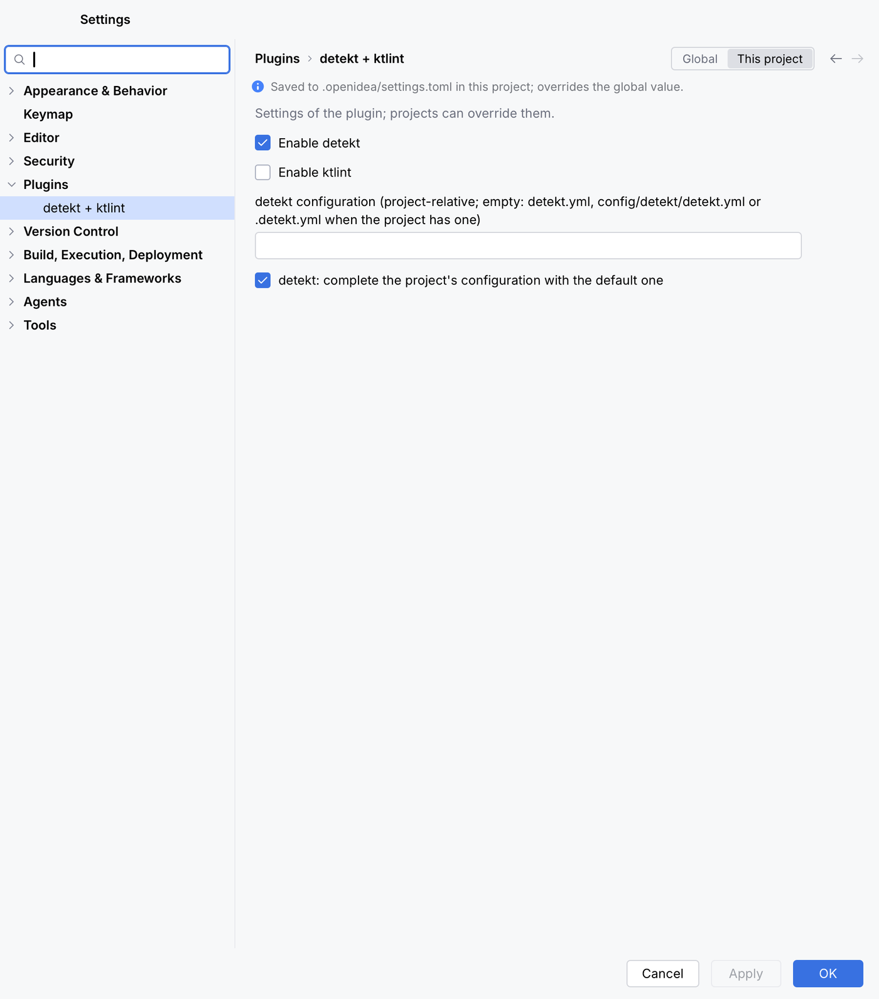

# detekt + ktlint

Community plugin for [OpenIDEA](https://github.com/l0ng-ai/openidea) (`dan548.detekt-ktlint`). After a Kotlin file is saved, or changed on disk by a quick fix or undo, it runs the detekt and ktlint command-line tools and shows their findings in the editor and the Problems view.

Install the CLI tools separately. The plugin offers suppression quick fixes and can format the current editor buffer with ktlint.

## Install the tools

Install the **command-line** programs yourself. A Gradle or Maven plugin in the project is not enough: OpenIDEA runs the programs named `detekt` and `ktlint`.

One way, with [Homebrew](https://brew.sh/) on macOS or Linux:

```sh
brew install detekt ktlint
```

The same program names from other package managers work too: Scoop (`scoop install detekt`, `scoop install ktlint`), SDKMAN (`sdk install detekt`), MacPorts (`port install ktlint`). Upstream install notes:

- detekt CLI: <https://detekt.dev> (Homebrew, Scoop and SDKMAN install a `detekt` command; the zip from GitHub launches `detekt-cli`)
- ktlint CLI: <https://ktlint.github.io/> (put the binary on `PATH` as `ktlint`)

Each tool needs a JDK. Homebrew’s formulas pull one in. Reports were checked against detekt 1.23.8 and ktlint 1.8.0.

If the file you installed is not literally named `detekt` or `ktlint` (the detekt zip’s launcher is `detekt-cli`), approve the grant below and choose that executable in Settings › Plugins. The plugin still calls the program name it declared; the IDE runs the file you pinned.

## Why `process:detekt` and `process:ktlint`

A plugin cannot start arbitrary programs. Each program is its own high-risk capability, named after the program: `process:detekt` and `process:ktlint`. They are **optional**. Installing the plugin does not run either tool until you grant that program. Settings › Plugins lists the grant and can pin the executable globally or for the current project (by path and content hash). The tools then run in the trusted project’s root.

Two grants, not one, so approving detekt does not also approve ktlint.

## Use only one tool

Either tool is enough.

- Grant only the program you installed. The other is skipped. The first time in a session that the plugin needs a missing or ungranted tool, it shows one warning and keeps the findings from the tool that did run.
- Or turn a tool off in this plugin’s settings (**Enable detekt**, **Enable ktlint**). A tool that is off is not started, even when its program is granted.

## Configure and turn checks off

Settings › this plugin:

| Setting | What it does |
| --- | --- |
| Enable detekt | Run detekt. On by default. |
| Enable ktlint | Run ktlint. On by default. |
| detekt configuration | Project-relative path to a detekt config. Empty: the first of `detekt.yml`, `config/detekt/detekt.yml`, `config/detekt.yml`, `.detekt.yml` that exists in the project. |
| detekt: complete the project's configuration with the default one | When a config file is used, pass `--build-upon-default-config`. On by default. |

detekt also picks up a baseline when the project has one of `config/detekt/baseline.xml`, `detekt-baseline.xml`, `baseline.xml`.

ktlint reads the project’s `.editorconfig` itself, because it is started in the project root. Rule options belong in that file, not in this plugin’s settings. There is no separate “enable a single ktlint rule” switch here: disable a rule in `.editorconfig`, or suppress it (below). Disable a detekt rule in the detekt config, or suppress it.

Commands, under the category **Kotlin Lint**:

- **detekt + ktlint: Check Current File**
- **detekt + ktlint: Clear Problems of Current File**
- **Format Current File with ktlint**

Checks also run on their own for `*.kt` and `*.kts` when the file is saved or written on disk.

A detekt run that exits 0 (clean) or 2 (findings) is shown. Exit 1 or 3 is a failed run: the message is the tool’s first output line, and that run adds no problems. ktlint is shown when it exits 0 or 1 and writes a SARIF report; any other result is reported as a failure. One tool failing does not drop the other’s findings.

## Format with ktlint

Use **Format Current File with ktlint** from Search Everywhere › Actions. The command requires ktlint to be enabled and granted `process:ktlint`. It formats the current Kotlin buffer, including unsaved changes, using the file’s `.editorconfig`. The plugin uses `editor.read` and `editor.write` to apply the result in a single Undo step. Saving follows OpenIDEA’s usual save and autosave settings.

ktlint 1.8.0 can corrupt output for files containing `%` when formatting from stdin. The plugin rejects output that loses percent characters. To format affected files, use a [ktlint version with the stdin formatting fix](https://github.com/ktlint/ktlint/pull/3281).

## Suppression quick fixes

On a finding, the light bulb offers:

- **Suppress \<rule\> for '\<declaration\>'** — inserts or extends `@Suppress("…")` on the enclosing `fun`, `class`, `interface`, `object`, `val`, `var`, `typealias` or `constructor`.
- **Suppress \<rule\> in file** — inserts or extends `@file:Suppress("…")` at the top of the file.

Kotlin’s `@Suppress` is not repeatable, so an annotation that is already there gains the rule instead of a second annotation. If that annotation already names the rule, no edit is offered.

The id inside the annotation is the rule detekt or ktlint actually matches:

- detekt: the rule name, for example `@Suppress("MagicNumber")`
- ktlint: the rule id prefixed with `ktlint:`, for example `@file:Suppress("ktlint:standard:no-wildcard-imports")`

An import has no declaration to hang the annotation on, so only the file suppression is offered. Applying a fix writes the file; the plugin checks that new text and moves or drops findings to match it. Undo is another disk change, and the findings come back.

## Screenshots

**Problems view and editor diagnostics**



**Suppression quick fixes**



**Per-project settings**



## Build

Rust 1.96 or newer (edition 2024; OpenIDEA 0.1.47’s toolchain) and the `wasm32-wasip2` target:

```sh
rustup target add wasm32-wasip2
cargo test
cargo fmt --check
cargo clippy --all-targets -- -D warnings
openidea-plugin build    # dist/plugin.wasm, then the same checks as Install from Disk
```

`openidea-plugin` is the `openidea-plugin-linux-x86_64.gz` asset of an OpenIDEA release, or `cargo install --locked --git https://github.com/l0ng-ai/openidea ide-host --bin openidea-plugin`. The dependency in `Cargo.toml` is the SDK at tag `v0.1.47` of that repository. The crate is not published to crates.io. That SDK’s WIT is `openidea:plugin@1.10.0`, and `plugin.toml` requires `engines.openidea = "^1.10"` (OpenIDEA 0.1.47). The behaviour itself — a private plugin directory, and checks after saves and other disk changes — has been in the API since 1.3.

Load this directory with `openidea-plugin link .`, then Settings › Plugins › Reload. Or use **Install Plugin from Disk…**.

## Marketplace

Install **detekt + ktlint** from the OpenIDEA Marketplace. Signed packages are attached to this repository’s [releases](https://github.com/dan548/openidea-detekt-ktlint/releases). The [Marketplace registry entry](https://github.com/l0ng-ai/openidea-plugins/blob/main/plugins/dan548.detekt-ktlint.toml) tracks the published versions and their SHA-256 hashes.
